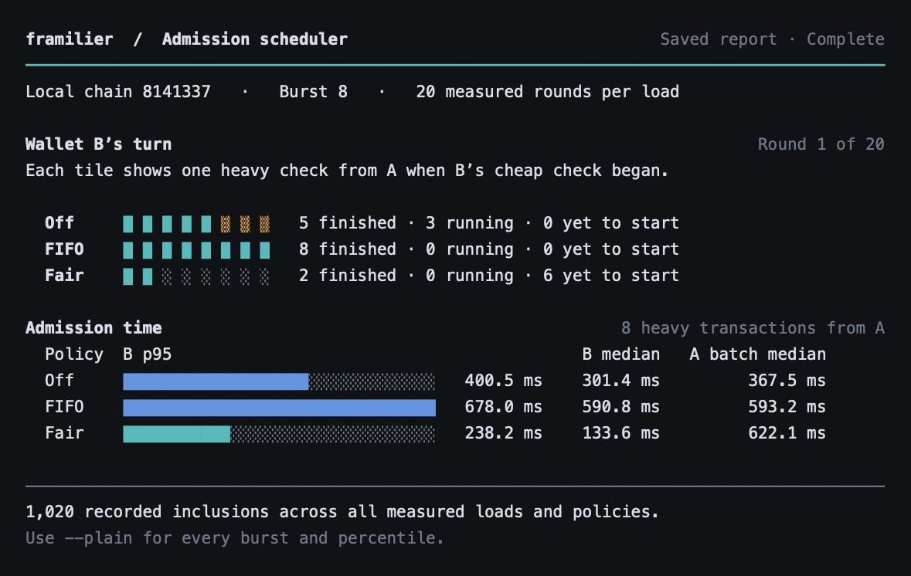

# framilier

framilier schedules transaction admission work for EIP-8141 alternative-mempool node operators. It measures whether limiting one sender's concurrent expensive checks lets another wallet get admitted sooner, and what that costs the busy sender's batch. Block builders still choose what gets included.

The sidecar supports **off**, **FIFO** and **fair** policies. Fair mode rotates senders, limits heavy concurrency per sender, bounds per-sender backlogs and shares an execution budget across admission, estimates and revalidation. This is operator resource control, not Sybil resistance or a guarantee of inclusion.

[Try the live comparison](https://framilier-live.tealdumpling1.chatgpt.site). See which checks started before wallet B, start a fresh one-round run, or explore the verified 20-round benchmark. To serve the same page locally after setup, run `./framilier live`. [Runner setup](docs/OPERATOR.md#browser-demo)

## Run and verify

To inspect the published experiments from a fresh clone, use Node.js 20.12 or newer. This command reads the checked-in samples and recomputes the report.

```sh
./framilier report sidecar/evidence/compare/merged-main-7d052e7 --verify
```



To run a live demo, build the sidecar with Bun and provide the pinned ethrex executable for your platform. The CLI creates and funds its own wallets on a private loopback chain. [One-time setup](docs/OPERATOR.md#prerequisites)

```sh
./framilier doctor
./framilier compare --rounds 1 --bursts 8
```

For 20 measured rounds per condition, use `./framilier compare --preset full`. Read wallet B’s admission time alongside wallet A’s batch completion time. [Operator guide](docs/OPERATOR.md) · [Recorded demo walkthrough](DEMO.md)

## Evidence and scope

| Local experiment, burst of eight | Policies compared | B admission | A median batch time |
| --- | --- | ---: | ---: |
| Apple Silicon, original scheduler at `7d052e7` | FIFO → fair | p95 678.0 → 238.2 ms | 593.2 → 622.1 ms |
| Linux, contributor’s PR #4 build | Off → fair | median 420.7 → 175.6 ms | 480.8 → 545.7 ms |
| Linux, same build, reversed policy order | Off → fair | median 378.3 → 168.9 ms | 401.1 → 487.4 ms |

Each policy and burst size had 20 measured rounds. The Linux runs recorded 1,620 measured inclusions across private chains. The workload is a synthetic Keccak hash chain. Timers end at admission, and receipts establish inclusion afterward. The review changes have a separate local smoke check. [Original Mac comparison](docs/BUILDER_BENCHMARK.md#scheduler-comparison-on-6-november-2026) · [Linux measurements and limitations](docs/HARDENING_VALIDATION.md)

## Inherited code and team additions

| Inherited | Added or changed for framilier |
| --- | --- |
| Workshop sidecar, codec, staking/reputation services, relay and explorer | Per-entity budget accounting, scheduler, shared simulation gate, duplicate suppression, recovery fixes and regression tests |
| Workshop tooling, staking registry and unmodified Hegota ethrex | Hash-chain workload, private producer, timing observer, policy comparison CLI and offline report verification |

Budget policy follows draft `BUDGET-010` revision `493ba8a`: 100,000 per unstaked entity and 1,000,000 per eligible staked entity, including sender signature costs. The early public checkpoint was `7c9594f`. [Upstream provenance](docs/UPSTREAM.md)

## framilier sidecar

On the organizers' replacement devnet (chain `1337`), the public sidecar admitted one **1,000,000-gas** hash-chain transaction. The stake mined in block 966. The sidecar later cancelled the workload transaction after four relay attempts. Its public execution simulation used 993,512 VERIFY gas. [Public admission](https://explorer.altmempool.wtf/tx/0x89d35f0f123f0ae0bca2f6775ecb6b0e46a168cc351aa8095be12a319b109e2a?node=https%3A%2F%2Faltmempool.forshtat.com%2Frpc) · [Relay history and operator question](docs/PUBLIC_RELAY_REPORT.md)

In two exploratory private-chain runs, a second wallet's median admission time was about **11 ms idle, 44–48 ms alongside four incorrect witnesses, and 129 ms alongside four correct witnesses**. Both busy conditions ran 9,664 hashes per candidate. All 72 measured probes and 96 expensive valid transactions mined. The measurements cover admission wall time on one Mac. [Method, raw trials and reproduction](docs/BUILDER_BENCHMARK.md)

On an isolated ethrex chain, a staked wallet verified a 9,664-step Keccak witness and mined in block 5. Its VERIFY frame consumed **993,512 of 997,200 declared execution gas**. One secp256k1 signature accounted for the remaining 2,800 of the 1,000,000-gas allowance. [Receipt and negative controls](sidecar/evidence/private-inclusion.json)

The local sidecar admitted a signed transaction from a staked wallet at exactly 1,000,000 declared validation gas. It rejected the same wallet at 1,000,001. The public execution node rejected the admitted bytes under its canonical mempool cap. See the [test record and run instructions](docs/SIDECAR.md).

## Historical public workshop baseline

At the recorded early checkpoint on 6 November 2026 (India time), the tested public sidecar enforced a **100,000-gas combined validation-prefix cap**, including signature-verification costs.

| Declared VERIFY execution allowance | Unstaked wallet | Staked wallet |
| --- | --- | --- |
| 70,000 | Admitted and mined; both frames succeeded | Admitted and mined; both frames succeeded |
| 500,001 | Rejected by the combined budget check | Rejected by the combined budget check |

The high-budget rejection was `500001 + 2800 signature cost = 502801 > MAX_VERIFY_GAS 100000`. Staking successfully relaxed the foreign-storage rule, but did not raise this deployment's budget cap. Each clean baseline actually used **10,081 gas in its VERIFY frame**: these are declared-allowance tests, not expensive-verification benchmarks.

See [the full test record](docs/TEST_RESULTS.md), [machine-readable results](framilier-probe/live-test-result.json), and [the changelog](CHANGELOG.md).

## What is in this repository

- `framilier-probe/framilier_probe.ts`: framilier's single-transaction budget probe; estimate-only by default.
- `framilier-probe/*.json`: public transaction receipts, rejection reports and setup diagnostics from the test run.
- `docs/TEST_RESULTS.md`: methodology, transaction hashes, findings and outstanding work.
- `docs/UPSTREAM.md`: the pinned upstream source and the boundary between upstream work and framilier changes.

The upstream workshop is a local dependency in `mempool-workshop/`; it is excluded from Git. Dependencies, compiled adapters, private participant state and ZIP checkpoints are also excluded. The forked sidecar, its tests and its boundary evidence live in `sidecar/`.

## Optional: set up the historical workshop probe

The workshop requires Node.js 20.12 or newer and Yarn 1. This run used Node.js 26.12.1 and Yarn 1.22.22.

From the framilier project root, on a fresh checkout without a `mempool-workshop/` directory:

```sh
git clone https://github.com/forshtat/mempool-workshop.git mempool-workshop
git -C mempool-workshop checkout bcfe02a196ca97b6fb0d1044db9d0b4c673831fc
cd mempool-workshop
yarn install --frozen-lockfile
cp ../framilier-probe/framilier_probe.ts src/steps/framilier_probe.ts
```

Read the upstream `README.md` and `AGENTS.md`. Set `gatewayUrl` in `mempool-workshop/workshop.config.json5` to the endpoint that successfully relayed this run:

```text
https://altmempool.forshtat.com/rpc
```

The recorded test network is chain **1337**. Endpoints and deployments may change when this demonstration network resets. Funding was a separate prerequisite; see the [recorded funding and routing issues](docs/TEST_RESULTS.md#funding-and-routing).

## Reproduce the historical probe checks

Run each command individually from `mempool-workshop/` and inspect its result before proceeding. On an existing configured workshop, **do not rerun `step_1_check`**: it resets the recorded deployed addresses and completed steps while retaining the participant key.

For a fresh participant, first complete setup and deploy the workshop's test wallet:

```sh
yarn step_1_check --json
yarn step_6_tx_violating_canonical --json
```

Step 6 intentionally submits a foreign-storage-access transaction that should be rejected while unstaked. The framilier probe uses that wallet's clean validation path instead.

Run the unstaked baseline, then the larger allowance only after the baseline is mined successfully:

```sh
yarn tsx src/steps/framilier_probe.ts --budget 70000
yarn tsx src/steps/framilier_probe.ts --budget 70000 --submit
yarn tsx src/steps/framilier_probe.ts --budget 500001 --submit
```

For the staked comparison, use the same wallet:

```sh
yarn step_7_stake --json
yarn step_8_tx_violating_alt --json
yarn tsx src/steps/framilier_probe.ts --budget 70000 --submit
yarn tsx src/steps/framilier_probe.ts --budget 500001 --submit
```

`--submit` submits exactly one candidate. A rejected budget probe exits with code 2; inspect the error and run `yarn step_11_debug <transaction-hash> --json` for its admission report. If a transaction remains pending, investigate that hash before submitting another probe. The documented run stopped after reproducing the explicit cap; it did not submit a 1,000,001-gas case or run the workshop's reputation-burn step.

## Historical workshop validation

```sh
yarn typecheck
yarn test
```

TypeScript checking passed with the probe included. **57 upstream tests across 14 files passed.** These are the workshop's tests, not a new framilier conformance suite. The live cases are recorded separately in the evidence files.

## Run the inclusion test

The [private block test](docs/SIDECAR.md#private-block-inclusion) starts a fresh Hegota execution node and framilier sidecar, deploys the wallet, stakes it, and checks the mined receipt against the canonical block.
